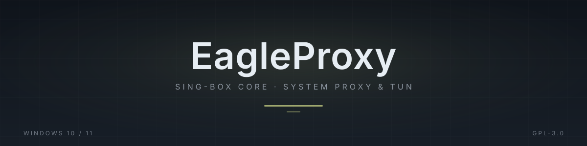
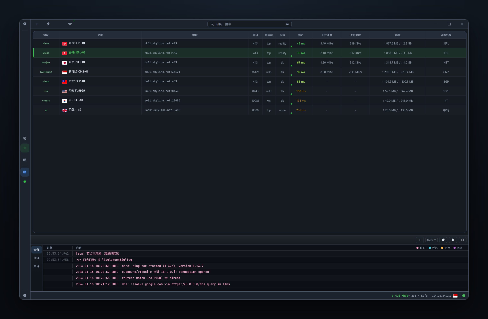
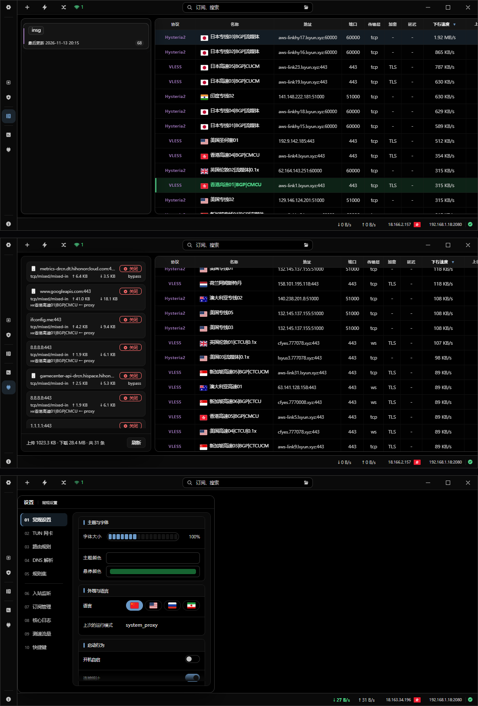

<p align="center">
  
</p>

<p align="center">
  <a href="https://github.com/sala-coding/EagleProxy/releases/latest"></a>
  
  
  
  <a href="LICENSE"></a>
</p>

<p align="center">
  <b>简体中文</b> · <a href="README_EN.md">English</a> · <a href="README_RU.md">Русский</a> · <a href="README_FA.md">فارسی</a>
</p>

<p align="center">
  
</p>
<p align="center">
  <sub>一个为 Windows 打造的 sing-box 桌面客户端<br>订阅、节点、双模式、规则与 DNS —— 一屏之内，操作可预期</sub>
</p>

<p align="center">
  <a href="https://github.com/sala-coding/EagleProxy/releases/latest"></a>
  <a href="https://github.com/sala-coding/EagleProxy/releases/latest"></a>
</p>
<p align="center">
  <sub>解压即用 · 不写注册表 · 不装服务 · 数据只留在自己的目录</sub>
</p>

---

## ✨ 特性

| 功能 | 说明 |
|---|---|
| **📥 订阅管理** | 链接导入，或直接读入本地 sing-box / Clash 配置文件；配额与到期自动解析，支持再导出为 sing-box / Clash / 分享链接 |
| **⚡ 热切换** | 组内换节点，内核不重启；TUN 预热，首次开启零等待 |
| **🧭 双模式** | 系统代理 / TUN，侧栏一键切换；系统代理绕过列表可自定义 |
| **📡 局域网共享** | 一个地址给全网使用，状态栏实时显示在线设备数 |
| **🧱 规则与 DNS** | `.srs` 规则集按国家管理，双列表延迟自动优选 |
| **🔎 状态观测** | 实时连接列表一键断开、流量统计、分类着色的日志 |

<p align="center">
  <sub>另有：全局热键与托盘常驻 · 简体中文 / English / Русский / فارسی 四种界面语言 · 关于卡一键检查更新</sub>
</p>

## 📸 界面

<p align="center">
  
</p>
<p align="center">
  <sub>订阅抽屉（配额进度条） · 实时连接（链路与一键断开） · 设置面板（就地停靠）</sub>
</p>

## 🚀 快速开始

| 附件 | 适合 | 内容 |
|---|---|---|
| `Eagle-v*-windows-full.zip` | 首次安装 | `Eagle.exe` + `sing-box\` 内核目录，解压即用 |
| `Eagle-v*-windows.exe` | 覆盖升级 | 仅程序本体，直接替换旧版即可 |

1. 从 [Releases](https://github.com/sala-coding/EagleProxy/releases/latest) 下载 **full zip** 并解压到任意目录（保持 `Eagle.exe` 与 `sing-box\` 同级）
2. 运行 `Eagle.exe`，导入订阅或粘贴分享链接
3. 在节点表格里选一个节点，点「启动」即可

> **系统要求**：Windows 10 / 11 x64。WebView2 缺失时启动会引导安装；TUN 模式首次开启需管理员授权。

## 🧩 内核

内核不内嵌：程序在自身目录、`sing-box\` 子目录与数据目录附近查找 `sing-box.exe`。设置 → 核心路径会列出找到的每一个内核，点选即可切换——所以多个内核版本可以并存，随时换。

## 🛠 从源码构建

需要 [Go](https://go.dev) 1.25+、[Node.js](https://nodejs.org) 18+、[Wails CLI](https://wails.io/docs/gettingstarted/installation) v2。内核自备：把 `sing-box.exe` 与 `wintun.dll` 放进 `sing-box/`，或在设置里指定路径。

```cmd
wails dev                                 :: 开发调试
wails build                               :: 打包，不带版本号
.\build\release.ps1 -Version vX.Y.Z       :: 正式发布，注入版本号
```

产物：`build/bin/Eagle.exe`。

## ⚖️ 声明

本项目仅是一个代理客户端程序，不提供、不分发任何节点或订阅服务；请遵守所在地区的法律法规。

---

<p align="center">
  <sub>内核 <a href="https://github.com/SagerNet/sing-box">sing-box</a> · 框架 <a href="https://wails.io">Wails</a> · 数据结构参考 <a href="https://github.com/MatsuriDayo/nekoray">nekoray</a> · 以 <a href="LICENSE">GPL-3.0</a> 发布</sub>
</p>
