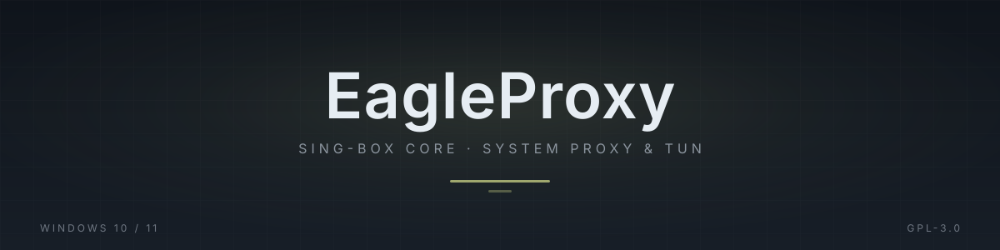
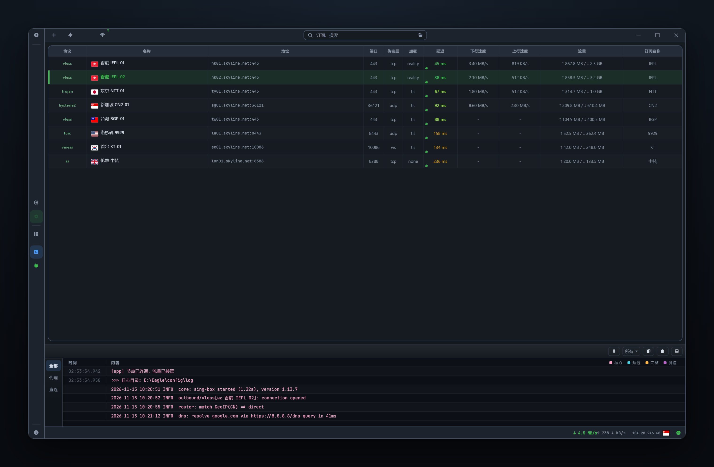
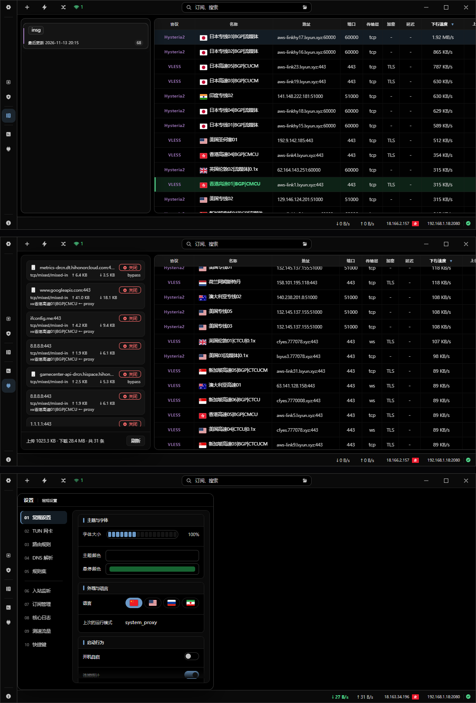

<p align="center">
  
</p>

<p align="center">
  <a href="https://github.com/sala-coding/EagleProxy/releases/latest"></a>
  
  
  
  <a href="LICENSE"></a>
</p>

<p align="center">
  <a href="README.md">简体中文</a> · <b>English</b> · <a href="README_RU.md">Русский</a> · <a href="README_FA.md">فارسی</a>
</p>

<p align="center">
  
</p>
<p align="center">
  <sub>A sing-box desktop client built for Windows<br>Subscriptions, nodes, two modes, rules and DNS — on one screen, predictable throughout</sub>
</p>

<p align="center">
  <a href="https://github.com/sala-coding/EagleProxy/releases/latest"></a>
  <a href="https://github.com/sala-coding/EagleProxy/releases/latest"></a>
</p>
<p align="center">
  <sub>Unzip and run · no registry · no service · data stays in its own folder</sub>
</p>

---

## ✨ Features

| Feature | Description |
|---|---|
| **📥 Subscriptions** | Import by link, or read local sing-box / Clash config files directly; quota and expiry parsed, with export back to sing-box / Clash / share links |
| **⚡ Hot switch** | Change node within a group, the core keeps running; TUN is prewarmed, the first switch waits for nothing |
| **🧭 Two modes** | System proxy / TUN, one click on the rail; the system proxy bypass list is yours to edit |
| **📡 LAN sharing** | One address for the whole network, live device count on the status bar |
| **🧱 Rules and DNS** | `.srs` rule sets managed per country, two lists, the fastest picked automatically |
| **🔎 Insight** | Live connection list with one-click close, traffic counters, colour-coded logs |

<p align="center">
  <sub>Also: global hotkeys and a tray icon · 简体中文 / English / Русский / فارسی · update check on the About card</sub>
</p>

## 📸 Screenshots

<p align="center">
  
</p>
<p align="center">
  <sub>Subscriptions drawer (quota bars) · live connections (chains, one-click close) · settings dock</sub>
</p>

## 🚀 Quick start

| Asset | For | Contains |
|---|---|---|
| `Eagle-v*-windows-full.zip` | first install | `Eagle.exe` + the `sing-box\` core folder, unzip and run |
| `Eagle-v*-windows.exe` | upgrade in place | the program only, drop it over the old copy |

1. Download the **full zip** from [Releases](https://github.com/sala-coding/EagleProxy/releases/latest) and unzip anywhere (keep `Eagle.exe` and `sing-box\` side by side)
2. Run `Eagle.exe`, import a subscription or paste share links
3. Pick a node in the table and press Start

> **Requirements**: Windows 10 / 11 x64. The app offers to install the WebView2 runtime when it is missing; TUN mode asks for administrator rights the first time it is switched on.

## 🧩 The core

The core is not embedded: the program looks for `sing-box.exe` beside itself, in the `sing-box\` folder next to it, and around the data directory. Settings → core path lists every core it finds — switching builds is a pick, so several versions can live side by side.

## 🛠 Building from source

Needs [Go](https://go.dev) 1.25+, [Node.js](https://nodejs.org) 18+ and the [Wails CLI](https://wails.io/docs/gettingstarted/installation) v2. The core is yours to provide: put `sing-box.exe` and `wintun.dll` in `sing-box/`, or point at them in the settings.

```cmd
wails dev                                 :: develop
wails build                               :: package, no version number
.\build\release.ps1 -Version vX.Y.Z       :: official release, version stamped
```

The artefact lands in `build/bin/Eagle.exe`.

## ⚖️ Disclaimer

This project is a proxy client only: it provides no nodes or subscription services of its own. Use it in accordance with the laws of your region.

---

<p align="center">
  <sub>Core <a href="https://github.com/SagerNet/sing-box">sing-box</a> · framework <a href="https://wails.io">Wails</a> · data structures after <a href="https://github.com/MatsuriDayo/nekoray">nekoray</a> · <a href="LICENSE">GPL-3.0</a></sub>
</p>
