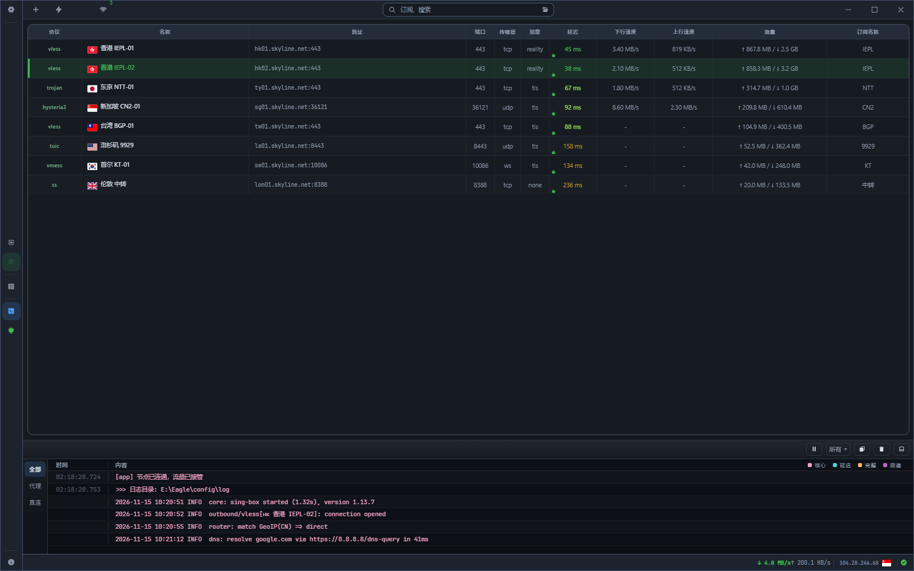
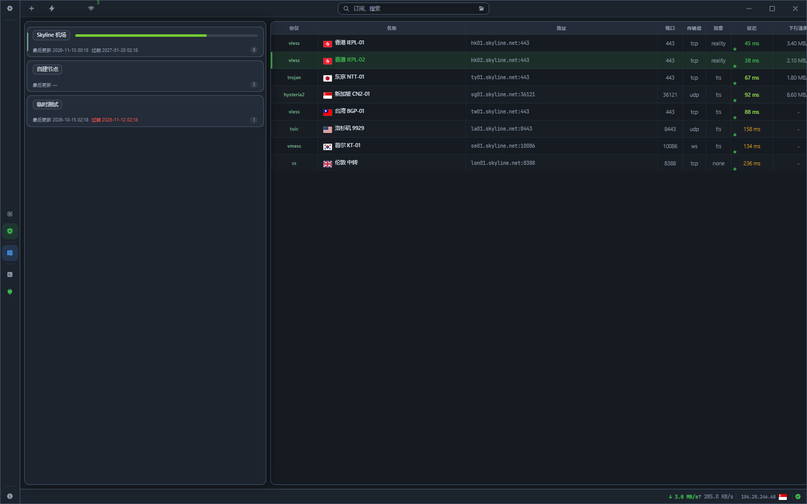
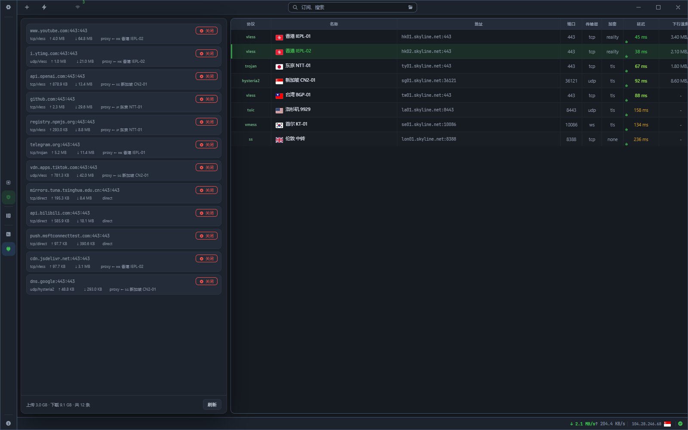
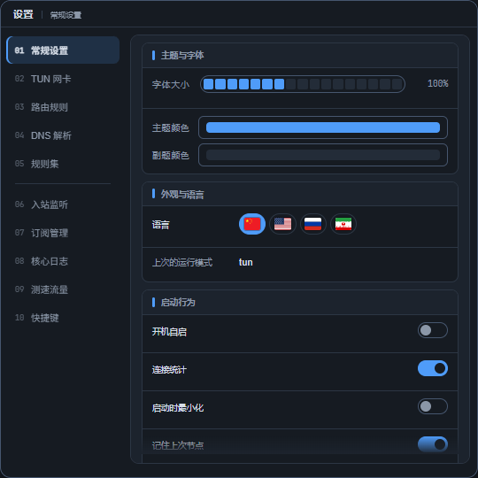

<p align="center">
  
</p>

<p align="center">
  <a href="https://github.com/sala-coding/EagleProxy/releases/latest"></a>
  
  
  <a href="LICENSE"></a>
</p>

<p align="center">
  <a href="README.md">简体中文</a> · <b>English</b> · <a href="README_RU.md">Русский</a> · <a href="README_FA.md">فارسی</a>
</p>

<p align="center">
  
</p>
<p align="center">
  <sub>Node table · hot switching · live rates and colour-coded logs — all real app windows</sub>
</p>

<p align="center">
  <a href="https://github.com/sala-coding/EagleProxy/releases/latest"></a>
  <a href="https://github.com/sala-coding/EagleProxy/releases/latest"></a>
</p>
<p align="center">
  <sub><b>full</b> for a first install, <b>exe</b> to upgrade in place · unzip and run · no registry · no service</sub>
</p>

---

### ✨ Features

<table>
<tr>
<td align="center" width="33%"><b>📥 Subscriptions</b><br><sub>links in, or import local<br>sing-box / Clash config files<br>quota and expiry parsed</sub></td>
<td align="center" width="33%"><b>⚡ Hot switch</b><br><sub>change node in a group<br>no core restart</sub></td>
<td align="center" width="33%"><b>🧭 Two modes</b><br><sub>system proxy / TUN<br>one click on the rail<br>TUN prewarmed, zero wait</sub></td>
</tr>
<tr><td colspan="3"><br></td></tr>
<tr>
<td align="center"><b>📡 LAN sharing</b><br><sub>one address for the network<br>live device count on the bar</sub></td>
<td align="center"><b>🧱 Rules and DNS</b><br><sub><code>.srs</code> per country<br>two lists, fastest picked<br>export sing-box / Clash / links</sub></td>
<td align="center"><b>🔎 Insight</b><br><sub>live connections, one-click close<br>colour-coded logs</sub></td>
</tr>
</table>

<p align="center">
  <sub>Also: global hotkeys and a tray menu · four interface languages · updates checked on GitHub</sub>
</p>

### 📸 Screenshots

<table>
<tr>
<td width="49.5%"></td>
<td width="49.5%"></td>
</tr>
<tr>
<td align="center"><sub>Subscriptions: quota bars and expiry warnings</sub></td>
<td align="center"><sub>Connections: traffic, chains, one-click close</sub></td>
</tr>
</table>

<p align="center">
  
</p>
<p align="center">
  <sub>The settings dock: theme / language / core / network, edited in one place</sub>
</p>

### 🚀 Quick start

1. Download `Eagle-v*-windows-full.zip` from [Releases](https://github.com/sala-coding/EagleProxy/releases/latest)
2. Unzip anywhere, keeping `Eagle.exe` and `sing-box\` side by side
3. Run `Eagle.exe`, import a subscription or paste share links, then start a node from the table

### 🧩 The core

The core is not embedded: the program looks for `sing-box.exe` beside itself, in the `sing-box\` folder next to it, and around the data directory. Settings → core path lists every core it finds — switching builds is a pick. Data stays in `config\` beside the program.

<details>
<summary><b>Building from source</b></summary>

Needs Windows 10 / 11 (the app offers to install the WebView2 runtime when it is missing), [Go](https://go.dev) 1.25+, [Node.js](https://nodejs.org) 18+ and the [Wails CLI](https://wails.io/docs/gettingstarted/installation) v2. The core is yours to provide: put `sing-box.exe` and `wintun.dll` in `sing-box/`, or point at them in the settings.

```cmd
wails dev
wails build                               :: package, no version number
.\build\release.ps1 -Version v1.0.18      :: official release, version stamped
```

The artefact lands in `build/bin/Eagle.exe`.

</details>

<p align="center">
  <sub>Core <a href="https://github.com/SagerNet/sing-box">sing-box</a> · framework <a href="https://wails.io">Wails</a> · data structures after <a href="https://github.com/MatsuriDayo/nekoray">nekoray</a> · <a href="LICENSE">GPL-3.0</a></sub>
</p>
