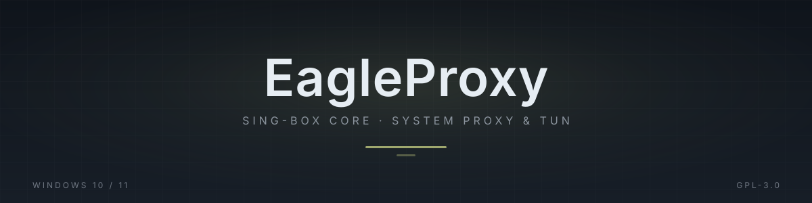
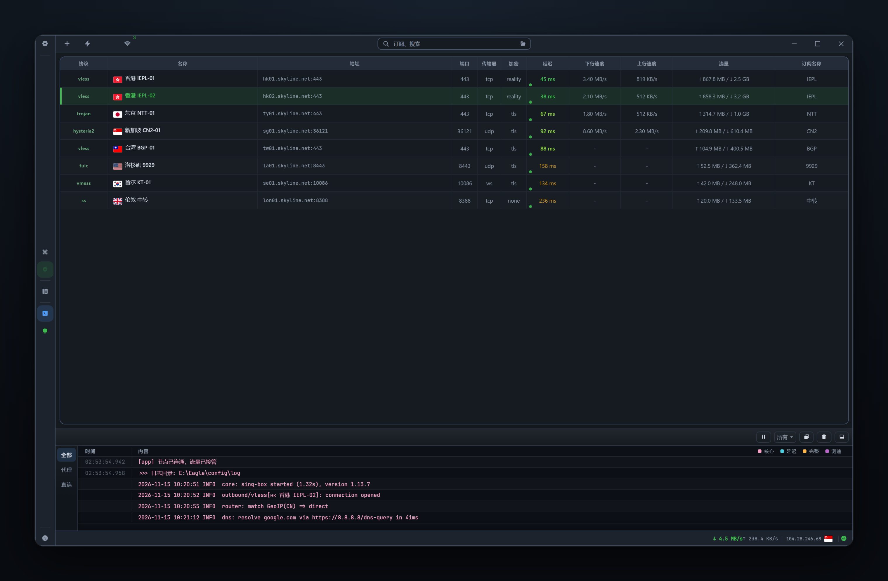
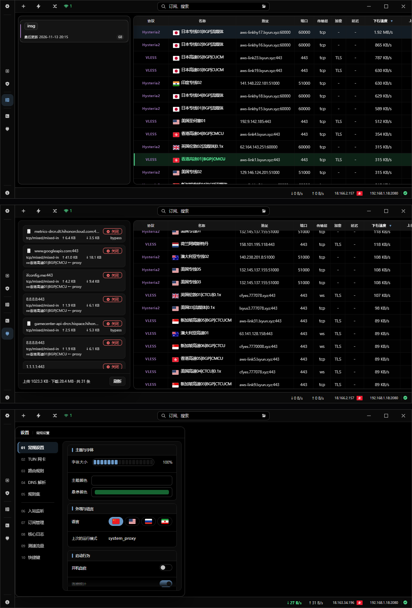

<p align="center">
  
</p>

<p align="center">
  <a href="https://github.com/sala-coding/EagleProxy/releases/latest"></a>
  
  
  
  <a href="LICENSE"></a>
</p>

<p align="center">
  <a href="README.md">简体中文</a> · <a href="README_EN.md">English</a> · <a href="README_RU.md">Русский</a> · <b>فارسی</b>
</p>

<p align="center">
  
</p>
<p align="center">
  <sub>کلاینت رومیزی sing-box برای ویندوز<br>اشتراک‌ها، نودها، دو حالت، قواعد و DNS — همه در یک نما، همه قابل پیش‌بینی</sub>
</p>

<p align="center">
  <a href="https://github.com/sala-coding/EagleProxy/releases/latest"></a>
  <a href="https://github.com/sala-coding/EagleProxy/releases/latest"></a>
</p>
<p align="center">
  <sub>از حالت فشرده خارج و اجرا کنید · بدون رجیستری · بدون سرویس · داده‌ها در پوشهٔ خودشان می‌مانند</sub>
</p>

---

## ✨ امکانات

| امکان | توضیح |
|---|---|
| **📥 اشتراک‌ها** | ورود با لینک یا خواندن مستقیم پیکربندی محلی sing-box / Clash؛ حجم و انقضا خودکار خوانده می‌شود، با برون‌بری به sing-box / Clash / لینک |
| **⚡ جابه‌جایی سریع** | تغییر نود در گروه بدون راه‌اندازی دوبارهٔ هسته؛ TUN از قبل گرم است، نخستین جابه‌جایی بدون انتظار |
| **🧭 دو حالت** | پروکسی سیستم / TUN با یک کلیک؛ فهرست دور زدن پروکسی سیستم قابل ویرایش است |
| **📡 شبکهٔ محلی** | یک نشانی برای همهٔ دستگاه‌ها، شمارندهٔ زنده روی نوار وضعیت |
| **🧱 قواعد و DNS** | بسته‌های قاعدهٔ `.srs` بر پایهٔ کشور، دو فهرست، سریع‌ترین خودکار انتخاب می‌شود |
| **🔎 پایش** | اتصال‌های زنده با قطع یک‌کلیکی، شمارش ترافیک، لاگ دسته‌بندی‌شده |

<p align="center">
  <sub>همچنین: کلیدهای میانبر و سینی سیستم · 简体中文 / English / Русский / فارسی · بررسی به‌روزرسانی در کارت «درباره»</sub>
</p>

## 📸 تصاویر

<p align="center">
  
</p>
<p align="center">
  <sub>کشوی اشتراک‌ها (نوار حجم) · اتصال‌های زنده · پنل تنظیمات</sub>
</p>

## 🚀 شروع سریع

| فایل | برای | محتوا |
|---|---|---|
| `Eagle-v*-windows-full.zip` | نصب نخست | `Eagle.exe` + پوشهٔ هستهٔ `sing-box\`، خارج از فشرده و اجرا |
| `Eagle-v*-windows.exe` | به‌روزرسانی روی نسخهٔ قبلی | فقط برنامه، روی نسخهٔ پیشین بگذارید |

1. **full zip** را از صفحهٔ [Releases](https://github.com/sala-coding/EagleProxy/releases/latest) دانلود و در هر پوشه‌ای از حالت فشرده خارج کنید (با `Eagle.exe` و `sing-box\` کنار هم)
2. `Eagle.exe` را اجرا کنید، اشتراک وارد یا لینک نود بچسبانید
3. از جدول یک نود را انتخاب و روشن کنید

> **نیازمندی‌ها**: ویندوز ۱۰ / ۱۱ نسخهٔ x64. اگر WebView2 نباشد برنامه پیشنهاد نصب می‌دهد؛ حالت TUN در نخستین روشن‌شدن دسترسی مدیر می‌خواهد.

## 🧩 هسته

هسته درون برنامه نیست: برنامه `sing-box.exe` را کنار خود، در پوشهٔ `sing-box\` و نزدیک پوشهٔ داده‌ها می‌جوید. در تنظیمات → مسیر هسته همهٔ هسته‌های یافته‌شده فهرست می‌شوند و انتخابشان یک کلیک است؛ پس چند نسخه می‌توانند کنار هم بمانند.

## 🛠 ساخت از سورس

[Go](https://go.dev) 1.25+، [Node.js](https://nodejs.org) 18+ و [Wails CLI](https://wails.io/docs/gettingstarted/installation) نسخهٔ ۲ لازم است. هسته را خودتان بگذارید: `sing-box.exe` و `wintun.dll` را در `sing-box/` بریزید یا مسیرشان را در تنظیمات بدهید.

```cmd
wails dev                                 :: اشکال‌زدایی
wails build                               :: بسته‌بندی بدون شمارهٔ نسخه
.\build\release.ps1 -Version vX.Y.Z       :: انتشار رسمی با شمارهٔ نسخه
```

خروجی: `build/bin/Eagle.exe`.

## ⚖️ بیانیه

این پروژه فقط یک کلاینت پروکسی است و هیچ نود یا سرویس اشتراکی‌ای عرضه نمی‌کند؛ مطابق قوانین منطقهٔ خود استفاده کنید.

---

<p align="center">
  <sub>هسته <a href="https://github.com/SagerNet/sing-box">sing-box</a> · چارچوب <a href="https://wails.io">Wails</a> · ساختار داده با الگوی <a href="https://github.com/MatsuriDayo/nekoray">nekoray</a> · <a href="LICENSE">GPL-3.0</a></sub>
</p>
