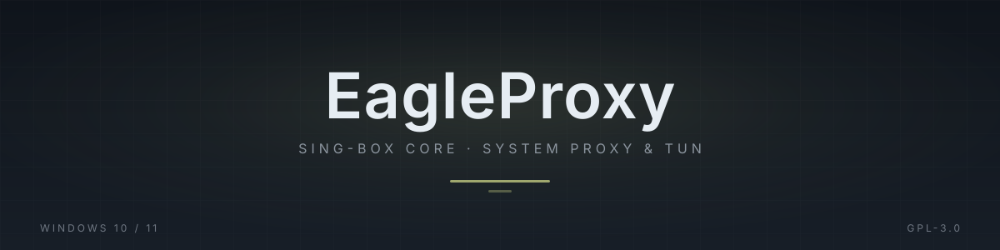
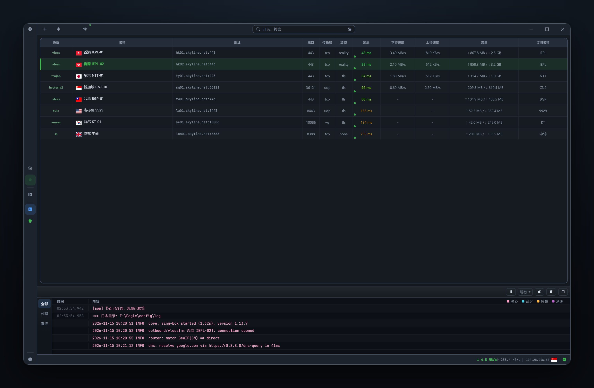
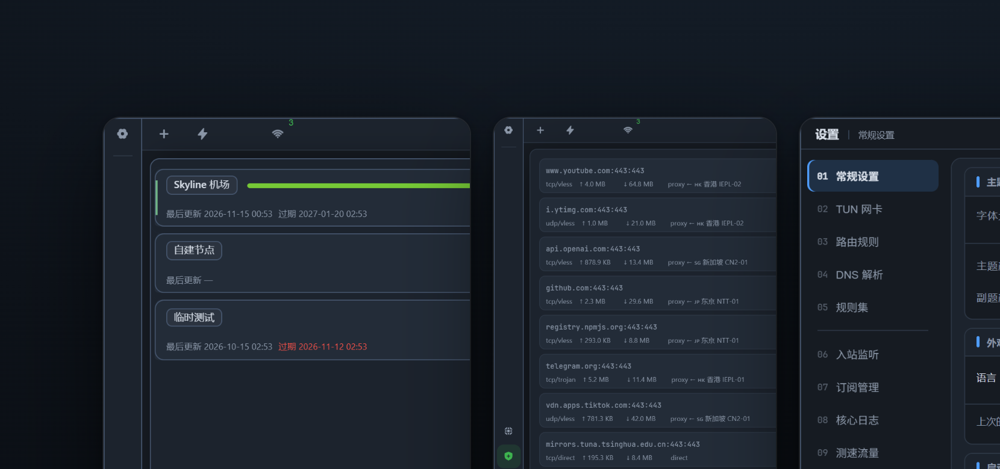

<p align="center">
  
</p>

<p align="center">
  <a href="https://github.com/sala-coding/EagleProxy/releases/latest"></a>
  
  
  <a href="LICENSE"></a>
</p>

<p align="center">
  <a href="README.md">简体中文</a> · <a href="README_EN.md">English</a> · <b>Русский</b> · <a href="README_FA.md">فارسی</a>
</p>

<p align="center">
  
</p>
<p align="center">
  <sub>Подписки, узлы, два режима, правила и DNS — на одном экране</sub>
</p>

<p align="center">
  <a href="https://github.com/sala-coding/EagleProxy/releases/latest"></a>
  <a href="https://github.com/sala-coding/EagleProxy/releases/latest"></a>
</p>
<p align="center">
  <sub><b>full</b> — для первой установки, <b>exe</b> — обновление поверх · распакуйте и запускайте · без реестра и служб</sub>
</p>

---

### ✨ Возможности

<table>
<tr>
<td width="50%" align="center"><b>📥 Подписки</b><br><sub>ссылки или локальные конфиги sing-box / Clash<br>лимит и срок разбираются</sub></td>
<td width="50%" align="center"><b>⚡ Горячее переключение</b><br><sub>смена узла в группе без перезапуска ядра<br>TUN прогрет заранее — без ожидания</sub></td>
</tr>
<tr>
<td align="center"><b>🧭 Два режима</b><br><sub>системный прокси / TUN, одним щелчком</sub></td>
<td align="center"><b>📡 Локальная сеть</b><br><sub>один адрес для всех устройств, счётчик на панели</sub></td>
</tr>
<tr>
<td align="center"><b>🧱 Правила и DNS</b><br><sub><code>.srs</code> по странам, два списка, быстрейший выбирается</sub></td>
<td align="center"><b>🔎 Наблюдение</b><br><sub>соединения в реальном времени, журнал по категориям</sub></td>
</tr>
</table>

<p align="center">
  <sub>Ещё: горячие клавиши и трей · четыре языка интерфейса · экспорт в sing-box / Clash / ссылки · проверка обновлений на GitHub</sub>
</p>

### 📸 Скриншоты

<p align="center">
  
</p>
<p align="center">
  <sub>Панель подписок (полосы лимита) · соединения в реальном времени · панель настроек</sub>
</p>

### 🚀 Быстрый старт

1. Скачайте `Eagle-v*-windows-full.zip` со страницы [Releases](https://github.com/sala-coding/EagleProxy/releases/latest)
2. Распакуйте в любую папку, сохранив `Eagle.exe` и `sing-box\` рядом
3. Запустите `Eagle.exe`, добавьте подписку или вставьте ссылки узлов и запустите узел из таблицы

### 🧩 Ядро

Ядро не встроено: программа ищет `sing-box.exe` рядом с собой, в папке `sing-box\` и рядом с каталогом данных. Настройки → путь к ядру показывают всё найденное — сборку можно выбрать, а не вписывать вручную. Данные лежат в `config\` рядом с программой.

<details>
<summary><b>Сборка из исходников</b></summary>

Нужны Windows 10 / 11 (при отсутствии WebView2 программа предложит его установить), [Go](https://go.dev) 1.25+, [Node.js](https://nodejs.org) 18+ и [Wails CLI](https://wails.io/docs/gettingstarted/installation) v2. Ядро нужно своё: положите `sing-box.exe` и `wintun.dll` в `sing-box/` или укажите путь в настройках.

```cmd
wails dev
wails build                               :: сборка без номера версии
.\build\release.ps1 -Version v1.0.18      :: официальный выпуск с номером версии
```

Результат: `build/bin/Eagle.exe`.

</details>

<p align="center">
  <sub>Ядро <a href="https://github.com/SagerNet/sing-box">sing-box</a> · каркас <a href="https://wails.io">Wails</a> · структуры данных по образцу <a href="https://github.com/MatsuriDayo/nekoray">nekoray</a> · <a href="LICENSE">GPL-3.0</a></sub>
</p>
